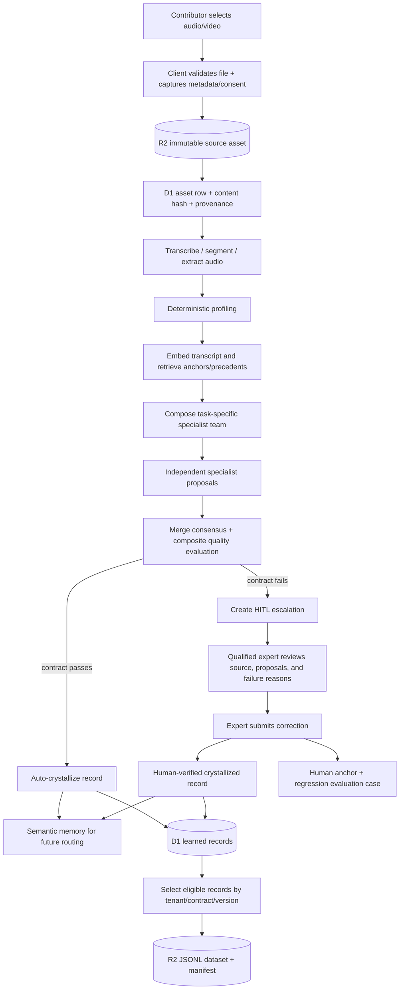
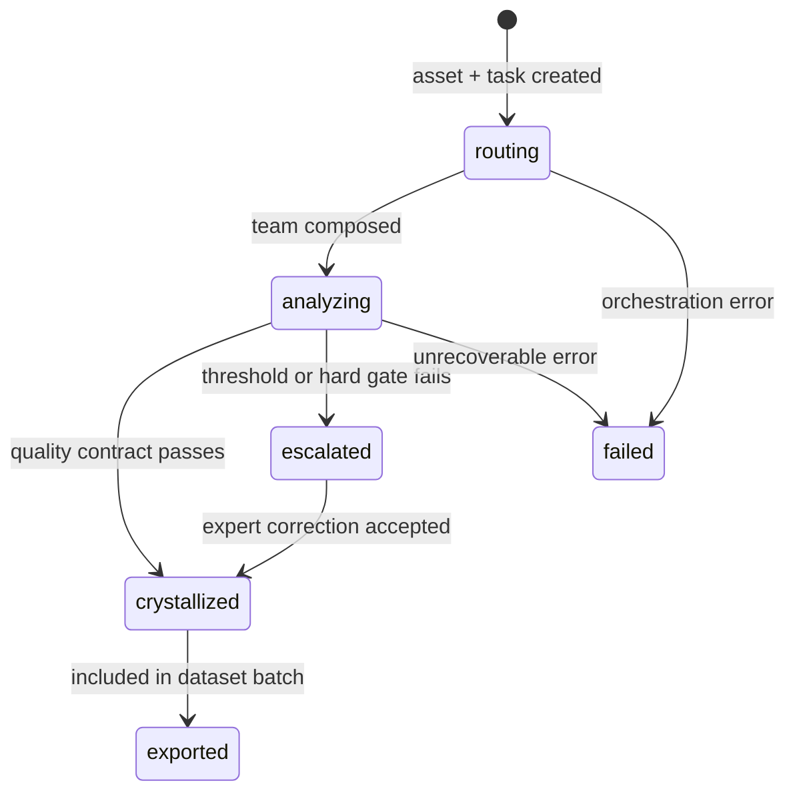

# IzwaAI media-to-learned-dataset workflow

This document follows one audio or video contribution from upload, through automated analysis and human-in-the-loop (HITL) review, to a versioned learned-dataset export. It describes the refinery implemented in `packages/domain/src/izwa` and the reference orchestration in `workers/refinery`.

> **Current implementation boundary:** the canonical API Worker in `apps/api` currently exposes only the Izwa health, quality-contract, and language-taxonomy routes. The complete ingest, negotiation, HITL, and export API exists in `workers/refinery/api.ts`, but is not yet mounted into `apps/api`. Media transcription, video demux, consent enforcement, and signed upload/download URLs are also still required. The intended production workflow below calls out those seams.

## Outcome

The upload itself is not the learned dataset. It becomes one immutable source asset. The refinery derives one or more auditable records from it, records the decisions and corrections that produced them, and then materializes eligible records as JSONL plus a manifest in R2.

```text
raw media
  + metadata and consent
  + machine proposals
  + quality evidence
  + human correction when required
  + full provenance
  = learned data record

many learned data records + a versioned contract = learned dataset export
```

## End-to-end flow



## 1. Upload and intake

### User experience

The contributor selects an audio or video file and supplies the context needed to use it responsibly:

- tenant or project;
- source and collection method;
- language/dialect hints, if known;
- speaker and recording metadata;
- consent, license, usage restrictions, and retention policy;
- optional transcript or field notes.

The client should validate type, size, duration, and required consent before upload. Large files should upload directly to R2 using a signed URL; the Worker should receive the resulting object key rather than proxying the entire file.

### Current API shape

The reference API accepts:

1. `PUT /api/izwa/assets/raw/:key` for raw bytes, currently capped at 32 MB; then
2. `POST /api/izwa/ingest` with an `audioKey`, or with inline `audioBase64` up to 8 MB.

`POST /ingest` also accepts `text`, `audioDurationSec`, `source`, `tenant`, `modality`, `meta`, and `async`.

### Persisted artifacts

- The media bytes live in R2 under `audio/<key>`.
- D1 receives an `izwa_assets` row containing `asset_id`, modality, tenant, source, SHA-style content hash, byte size, MIME type, optional text, R2 key, profile, metadata, and creation time.
- An `ingest` provenance event links the source asset to subsequent work.

The content hash gives the system a stable deduplication signal. The source bytes should be immutable: corrections create new derived records rather than overwriting evidence.

### Required media-processing seam

The current code does **not** transcribe audio, extract audio from video, identify speakers, or segment long recordings. Before profiling, production needs a media-preparation stage:

```text
video → demux audio → normalize codec/sample rate
audio → voice activity detection → segments → speech-to-text
                                  ↘ timestamps / speaker labels / confidence
```

Its transcript and time-aligned segments should become derived assets linked to the original source. Without a supplied transcript, the current specialists receive an empty text string, so audio-only input cannot yet yield a meaningful language record.

## 2. Deterministic profiling

`profileInput` performs cheap, non-generative inspection before any specialist-model spend. It determines or estimates:

- modality (`audio`, `video`, `text`, and other supported values);
- language and script hints;
- public versus sensitive content based on basic PII signals;
- low/medium/high complexity;
- duration and text-length indicators;
- a duplicate/content-hash signal.

These are routing hints, not facts. For example, language detection uses small heuristic word banks and must never replace expert verification.

The system resolves the active versioned quality contract at this point. The built-in `language-v1` contract requires a non-empty transcription, phonetic annotation, morphology, syntax, and language. Optional fields include dialect, English alignment, and code-switch spans.

## 3. Retrieval and routing

The transcript (or fallback hint text) is embedded with the configured embedding model. Vectorize is queried twice:

- nearest `dialect_anchor` and `human_anchor` vectors provide routing evidence;
- nearest `semantic` vectors provide precedents from previously crystallized records.

The router then composes a specialist team for this specific task. Potential roles are:

| Specialist | Primary output |
|---|---|
| Phonetics | IPA/segment-level phonetic evidence; included for audio/video |
| Morphology | Morpheme boundaries, roots, affixes, and tags |
| Syntax | Clause/constituent structure |
| Semantics | Meaning units and alignment |
| Dialect variation | Dialect/variant attribution |
| Code-switching | Language boundaries and spans |
| Translation | Faithful gloss and register notes |

Low-complexity text can use a reduced team. Audio/video includes phonetics. Every seat receives a distinct prompt version and a slice of retrieved evidence; this “independence vector” prevents several identical model calls from being mistaken for independent agreement.

A D1 `izwa_tasks` row is created with status `routing`, the selected contract, and the serialized team. One `SwarmCoordinator` Durable Object instance owns the task lifecycle.

## 4. Independent specialist analysis

The coordinator changes the task to `analyzing` and fans out to specialist Durable Objects in parallel. Each specialist returns a structured proposal:

```json
{
  "proposalId": "proposal_…",
  "specialistRole": "morphology",
  "modelId": "…",
  "promptVersion": "morphology:v1:1",
  "confidence": 0.88,
  "uncertainty": [],
  "payload": {},
  "evidenceIds": []
}
```

Every proposal, its model/prompt identity, evidence slice, uncertainty, and provenance is stored in D1. A failed specialist does not abort the whole task; it becomes a zero-confidence empty proposal so the quality engine sees the missing coverage.

Proposals are advisory. They cannot write canonical learned records directly.

## 5. Consensus and quality gates

The coordinator fills a consensus payload from the independent proposals. It then checks that payload against the active data contract and calculates a composite quality score from:

- semantic agreement between proposal embeddings;
- deterministic schema/rule validation;
- retrieved-evidence coverage;
- consistency with dialect/human anchors;
- historical evaluator performance;
- domain constraints;
- similarity-weighted human-verification history.

For the built-in language contract, the overall threshold is `0.78`. It also has hard minimums: model agreement `0.70`, deterministic validation `0.90`, and evidence coverage `0.60`. A high weighted average cannot hide a failed hard gate.

The decision and every component score are persisted. From here the workflow branches.

## 6A. Straight-through crystallization

When the contract threshold and every hard gate pass:

1. The task becomes `crystallized`.
2. D1 receives an `izwa_records` row with the consensus payload, quality breakdown, `verification_status: "auto"`, model/prompt versions, schema version, and provenance.
3. The record starts with `export_status: "pending"`.
4. The payload is embedded and written to Vectorize as `semantic_<recordId>`.
5. Similar future inputs can retrieve this accepted precedent.

“Auto” means contract-verified by the automated gates, not human-verified.

## 6B. Human-in-the-loop escalation

When the score is too low or a hard gate fails, the system does not discard the work and does not silently accept it.

### Escalation package

An `izwa_escalations` row captures:

- overall score, threshold, and failed gates;
- component scores;
- every specialist payload, confidence, and uncertainty;
- source asset and task references;
- status (`open`, `claimed`, `resolved`, or `rejected`).

The expert router attempts to pre-claim the escalation for a qualified active linguist, using task class, language coverage, load, and historical resolution statistics.

### Expert review experience

The annotator should see the original playable media beside:

- time-aligned transcript/segments;
- machine consensus;
- individual specialist proposals and disagreements;
- retrieved precedents and anchor evidence;
- contract violations and exact failed quality gates;
- editable fields for transcription, language/dialect, phonetics, morphology, syntax, alignment, and code-switching;
- an explicit resolution note.

The expert submits `taskId`, `escalationId`, `expertId`, a structured `correction`, and `resolutionText` to `POST /api/izwa/resolve`.

### Resolution and learning

The correction is layered over the machine consensus and crystallized with `verification_status: "human_verified"` and `verified_by: <expertId>`. Resolution then produces three learning effects:

1. **Routing learns:** the resolution is embedded as a `human_anchor` in Vectorize, making similar future inputs easier to route.
2. **Evaluation learns:** the failed input and human-verified expected output become an active regression evaluation case.
3. **Organizational memory learns:** an episodic HITL resolution event and complete provenance chain are stored.

The escalation closes, its resolved record ID is attached, and the task becomes `crystallized` with phase `resolved`.

## 7. Provenance and lineage

At every material transition, `izwa_provenance` records the step, referenced object, and details. A learned record can therefore be traced through:

```text
source asset
  → ingest/profile
  → retrieved evidence and routing team
  → specialist proposals and model versions
  → quality decision
  → automatic crystallization OR expert correction
  → final record
  → dataset export
```

`GET /api/izwa/tasks/:taskId/lineage` is the reference read path. This lineage is required for audit, deletion/consent requests, dataset cards, and debugging model regressions.

## 8. Learned-dataset export

`POST /api/izwa/export` selects crystallized records for a tenant (currently up to 200 by default, capped at 500), joins each record to its source asset and lineage, and writes two R2 objects:

```text
exports/<exportId>.jsonl
exports/<exportId>.manifest.json
```

Each JSONL row follows the language contract and includes:

- `record_id` and `source_id`;
- R2 audio reference;
- transcription, language, and dialect;
- phonetic annotation and semantic alignment;
- composite quality score;
- automatic or human-verification status and verifier;
- specialist model/prompt versions;
- schema version;
- provenance summary.

The manifest contains the export ID, format, contract ID/version, tenant, record count, field list, and creation time. Exported D1 records are marked `exported`.

### Production versioning requirement

The current exporter materializes a batch, but a production learned dataset should also have a durable dataset/version entity with:

- immutable version ID and content hash;
- exact record IDs and inclusion query;
- contract and taxonomy versions;
- train/validation/test split policy;
- license/consent policy and data card;
- quality distributions and language/dialect coverage;
- parent version and changelog;
- revocation/tombstone handling.

That prevents a later export from silently changing what “version 1” meant.

## State model



## Storage map

| Artifact | Store | Purpose |
|---|---|---|
| Original audio/video | R2 `IZWA_ASSETS` | Immutable evidence |
| Dataset JSONL and manifest | R2 `IZWA_ASSETS` | Distribution artifact |
| Assets, tasks, proposals, records | D1 | Transactional control-plane metadata |
| Escalations, experts, eval cases | D1 | HITL and evaluation state |
| Provenance and memory | D1 | Auditability and learning history |
| Dialect/human/semantic anchors | Vectorize `IZWA_INDEX` | Routing and precedent retrieval |
| Task negotiation state | Durable Object | Single-owner orchestration |
| Embeddings/specialist inference | Workers AI or configured provider | Machine representations and proposals |

## Production gaps to close

The workflow is architecturally coherent, but these items must be implemented before claiming complete media-to-dataset operation:

1. Mount the full refinery routes and Durable Object classes into `apps/api` (or deploy them as a separately bound Worker).
2. Add direct, resumable R2 uploads and real MIME preservation instead of treating every upload as WAV.
3. Add video demux, audio normalization, speech-to-text, timestamps, diarization, and long-media segmentation.
4. Define segment-level assets/tasks so one long recording does not become one oversized record.
5. Enforce authentication, tenant isolation, roles, consent, licenses, retention, PII redaction, and deletion propagation.
6. Build the annotator UI for claim/review/reject/resolve and expert conflict adjudication.
7. Validate expert corrections against the contract before crystallization; the current resolve path calculates quality but still writes the human-corrected record.
8. Add immutable dataset/version tables, split generation, data cards, revocations, and signed export access.
9. Add queues/workflows, idempotency, retries, dead-letter handling, and observability for long-running media jobs.
10. Calibrate quality weights and thresholds against labeled, human-reviewed evaluation data.

## One-sentence mental model

IzwaAI preserves the user's media as evidence, asks independent specialists to propose structured interpretations, uses a versioned quality contract to decide what can be trusted, sends uncertainty to the right human, turns that correction into both a verified record and future learning, and exports only crystallized records as an auditable learned dataset.
